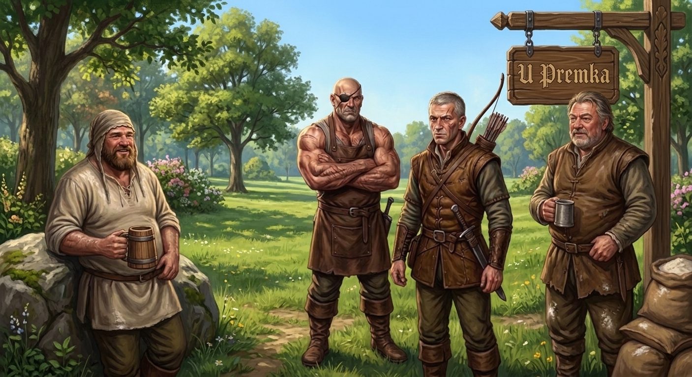
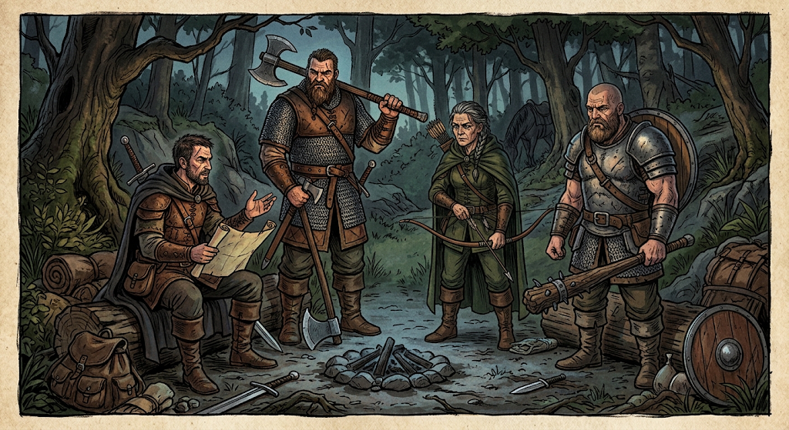

# Session 001

Each one of you has vague memories of living and breathing in a world when all goes blank. The next thing you remember is an endless fog. It seems like a dream: just like what the old man was saying.

Eventually you managed to climb a hill and there you found a group of people including a meek human priest, angry warlock human teenager,  slightly old slightly chubby tabaxi who has a way with words and an unusually strong woman with a slight green tint. 

There was an old man that kept crying, a merchant with a guard  who wanted to make an alliance. There appeared a hunter, with an huge bow and after he spoke of a game to play, he shot the merchant's guard dead with one arrow. All the people ran in panic into a fog that they new was full of dogs that were tearing them apart.

You also fought in the fog, and from time to time when you found a hill, some of you took a peak. At times an arrow or too flew by close.

At some point Verlorean managed to see a forest the old man spoke of from on of the hills and you started heading out that way. Unfortunately, to distract the dogs, you put some food on the ground, but the scent brought them on your tracks. 

On the way Verlorean tried to carry Tails, but he decided to command her to stop. As she was "groveling" the dogs finally caught up and attacked.

Second battle done, you traveled further, arrived at a river that had a powerful stream.  Following the river, you reached a marshy part, where maybe one could imagine it was possible to cross. Across the river was the forest you were looking for, but you got attacked again, this time including a devil like dog that luckily died soon. 

You managed to cross the marsh, and when you exit the fog, it is as if a wall closed behind you. You can see the fog behind you, but it appears completely opaque. Instead, ahead of you is a green warm, sunny forest. 

Exhausted, spent, you are happy to finally see color again, the deep scent of the forest seems like the refuge you are looking for. You can all tell you are in a different world from your own. This is a different, more "used up", world, as if it was stretched up like a drum skin, a little too thin. But the feeling passes soon and you are grateful the fog is long behind you.

# Session 002

### Session Summary

**Arrival at the Village**
The party notices an unnatural phenomenon: moss growing uniformly on all sides of the surrounding trees. Upon entering the village, their presence draws curiosity and light scrutiny from the locals due to their strange demeanor. However, they are quickly accepted and make their way to the local inn, where they begin gathering information on the region's mounting troubles.

**Interrogating Danil**
The group corners Danil to extract intelligence. To break his silence, they sever one of his toes, forcing him to confess details about his four companions nearby and the larger bandit network operating in the region.

**Cultural Adaptation & The Inn**
While sharing drinks and discussing their backgrounds at the tavern, the party takes note of local peculiarities: both the currency and the written script differ from what they know, with the alphabet closely mirroring Czech. During the evening, tensions flare when Tails attempts to execute the captive Danil, but Laszlo intervenes and stops him.

**Confronting the Scouts**
The next morning, the party sets out and tracks down the remaining scout party after roughly two hours of searching. They encounter the four bandits: Hurd, Hund, Braghua, and Dortmund.

During the confrontation, the leader explains their situation:

* **Background:** They were originally an independent group, but were forcibly subsumed into a much larger bandit outfit led by **Bogdan**, who commands around 40 thugs.
* **Brutal Tactics:** The larger syndicate engages in ruthless acts—such as slaughtering halflings during caravan raids purely to fabricate false leads and confuse investigators.
* **The Mission:** The four were posted to monitor the village and report on its vulnerabilities. Weary of the senseless violence, they have been intentionally delaying actions by sending back false reports claiming the village is poor and not worth raiding.
* **Danil’s Role:** Danil was placed among them by Bogdan to keep them inline, and his growing impatience was threatening their delay tactics.
* **The Threat:** Fearing brutal retaliation from Bogdan’s overwhelming numbers, the four refuse to abandon their post or betray the syndicate without a clear, decisive advantage.

**An Uneasy Alliance**
Recognizing a potential opportunity, the priest tosses a coin to the scouts, striking a deal: if the situation in the village changes or danger approaches, they are to signal the party by shooting an arrow into the inn's hanging sign.

### Hradek's four

### Hurd's Band

# Session 003

- **Encounter with Brown Leaf:** After leaving the bandits, the group realizes they are being followed. A fast-talking, socially awkward hobbit named **Brown Leaf** jumps out and introduces himself. He reveals he overheard them discussing defeating Bogdan’s main group of bandits and proposes an alliance, inviting them to visit his people for mutual help. 
- **The Resupply Trip:** The group insists on returning to Hradek to resupply, primarily wanting beer—partly out of stubbornness and partly to use as a bribe for the bandits (with Laszlo arguing one keg will suffice). As they depart, Hradek, Laszlo notes that they could lend their support if the party actually have a decent plan. Brown Leaf tells them it takes a day. They make the forced march to arrive next morning.
- **The Journey:** Upon returning to him an hour later, Brown Leaf sets a quick pace through the forest toward his camp. The group nearly loses track of him twice before he suddenly halts them because he smells something ahead.
- **The Ambush:** Ahead are four bandits from Bogdan's group lying in wait to capture something. They spot members of the party. Negotiations fail, and Brown Leaf promptly vanishes into the landscape. The bandits attack, but the heroes win the fight using tactical positioning (a good wall) and stealthy support from Brown Leaf -- who is a tough fucker.
- **Arrival at the Hobbit Camp:** After looting the gear from the fight, the group travels to the hobbit camp. Although they realize they’ve been shadowed by hobbit sentries for the final 5–10 minutes, they arrive safely and are about to encounter Blue. They have made a forced march, are tired and if they do not rest will be exhausted.
